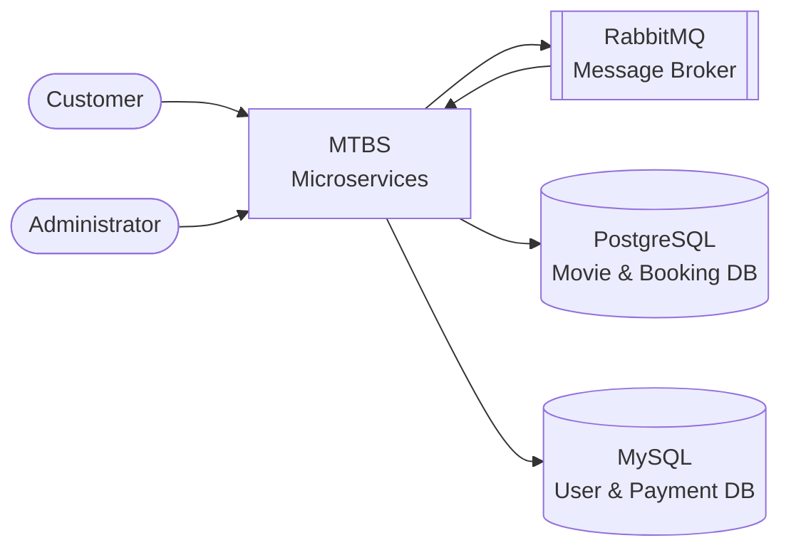
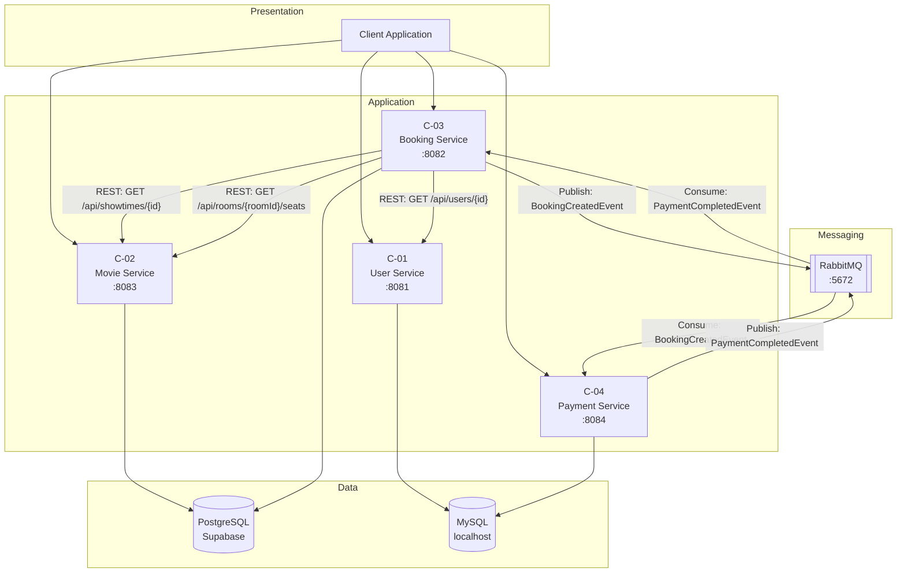
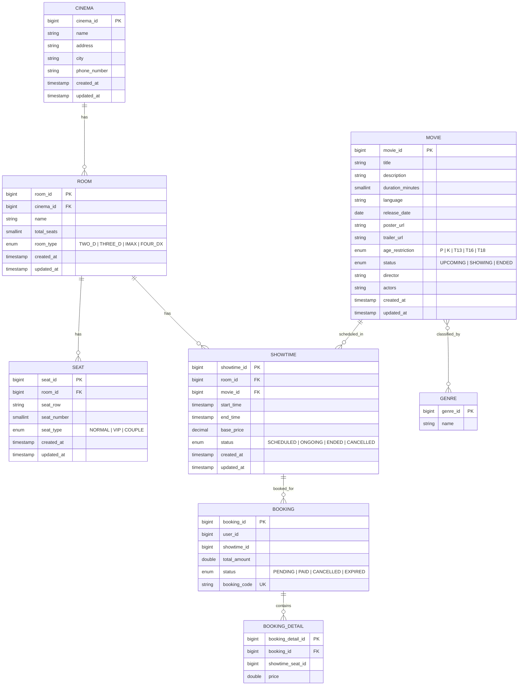
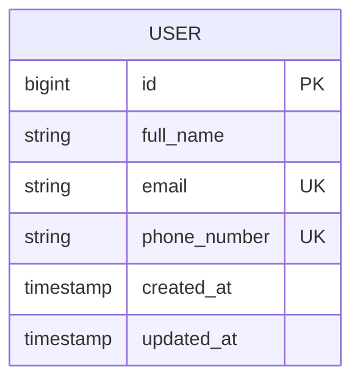
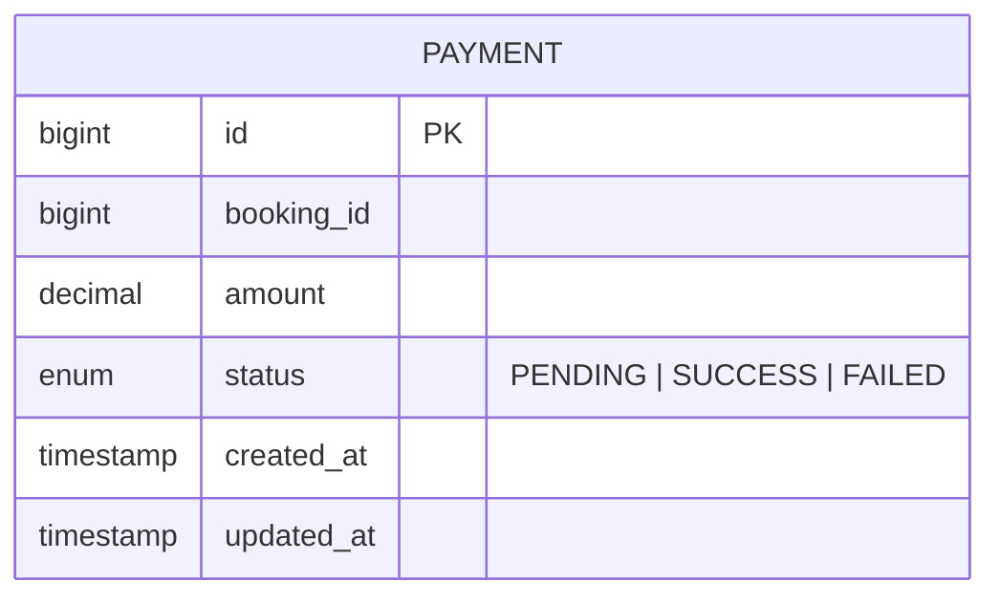
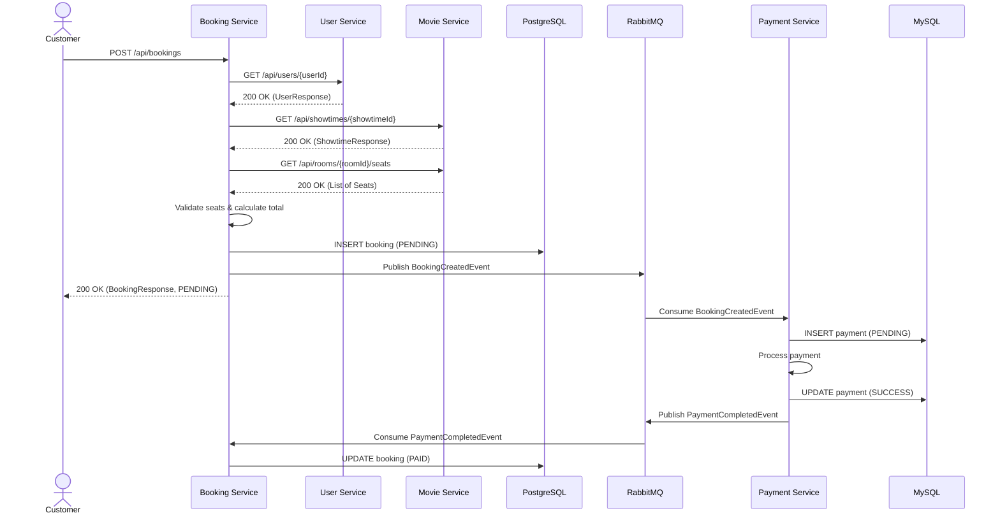

# System Design Document (SDD) — Movie Ticket Booking System

---

## Document Information

| Item           | Value                                          |
|----------------|------------------------------------------------|
| System name    | `Movie Ticket Booking System (MTBS)`           |
| Version        | `0.1`                                          |
| Status         | Draft                                          |
| Release        | `1.0`                                          |
| Date           | `2026-10-05`                                   |
| Author         | `Hoàng Thanh Diệu, Backend`                   |
| Approver       |                                                |
| Classification | Internal                                       |

## Revision History

| Version | Date       | Author             | Sections | Change        |
|---------|------------|---------------------|----------|---------------|
| 0.1     | 2026-10-05 | Hoàng Thanh Diệu    | All      | First version |
|         |            |                     |          |               |

---

# 1. Introduction

## 1.1 Purpose and Scope

This document describes the design of the Movie Ticket Booking System (MTBS), release 1.0. It covers all four microservices: User Service, Movie Service, Booking Service, and Payment Service. It also covers the database design, the RabbitMQ message broker, and the REST API interfaces between the services. This document does not cover the frontend client application. The frontend has a separate design document.

## 1.2 Audience

| Reader                  | Sections to read   |
|-------------------------|---------------------|
| Project manager         | 1, 2, 3             |
| Developer               | 4, 5, 6             |
| Database administrator  | 5                   |
| Infrastructure engineer | 4.4, 7              |
| Security engineer       | 3.2, 7.2, 7.3       |
| Tester                  | 6, 7.1, Appendix A  |

## 1.3 Referenced Documents

| ID     | Document                           | Version | Link                                                                                    |
|--------|------------------------------------|---------|-----------------------------------------------------------------------------------------|
| REF-01 | SDD Template                       | 0.1     | `docs/SDD-Template.md`                                                                  |
| REF-02 | User Service README                | 1.0     | `user-service/README.md`                                                                |
| REF-03 | GitHub Issue #3 — User Service     |         | https://github.com/kdieu4/MoiveTicketBookingSystem/issues/3                             |

---

# 2. System Overview

## 2.1 Background

Many cinemas in Vietnam still use manual or paper-based processes to manage movie screenings and ticket sales. This makes the booking process slow and error-prone. Customers cannot check seat availability or book tickets online. The MTBS system solves this problem. It gives customers a way to browse movies, select showtimes, choose seats, and pay for tickets through a digital platform.

## 2.2 Functions

**The system does these functions:**

1. Manage user information (create, read user profiles).
2. Manage movie catalog (create, read, update, delete movies).
3. Manage cinemas, rooms, and seats.
4. Manage showtimes (schedule movies in rooms with a base price).
5. Manage genres and associate them with movies.
6. Create bookings (select a showtime and seats, calculate the total amount).
7. Process payments for bookings through an event-driven pipeline.
8. Update booking status automatically after payment completion.

**The system does not do these functions:**

1. User authentication, authorization, JWT, and role management (planned for a later release).
2. Online payment gateway integration with third-party providers (VNPay, MoMo, etc.).
3. Email or SMS notification to customers.
4. Seat availability tracking in real time (current implementation validates seats by room but does not lock seats).
5. Admin dashboard or frontend client application.
6. Refund or cancellation workflow.

## 2.3 Context Diagram

---

# 3. Design Decisions

## 3.1 Assumptions and Dependencies

| ID    | Type       | Statement                                                                      | Result if the statement is false                                              | Owner |
|-------|------------|--------------------------------------------------------------------------------|-------------------------------------------------------------------------------|-------|
| AS-01 | Assumption | The peak load is less than 200 concurrent users.                               | The design needs more service instances and a load balancer.                  |       |
| AS-02 | Assumption | Each showtime has at most 300 seats.                                           | The seat validation loop in BookingServiceImpl needs optimization.            |       |
| AS-03 | Assumption | Authentication and authorization are not necessary in release 1.0.              | All endpoints are publicly accessible. A security layer is necessary later.   |       |
| DP-01 | Dependency | RabbitMQ is available on localhost:5672.                                        | The booking-to-payment event pipeline does not work.                         |       |
| DP-02 | Dependency | PostgreSQL (Supabase) is available on the configured host.                     | Movie Service and Booking Service cannot start.                              |       |
| DP-03 | Dependency | MySQL is available on localhost:3306.                                           | User Service and Payment Service cannot start.                               |       |

## 3.2 Constraints

| Area          | Constraint                                                             | Effect on the design                                                                  |
|---------------|------------------------------------------------------------------------|---------------------------------------------------------------------------------------|
| Technology    | Java 17 or 21, Spring Boot 3.3.5 / 4.1.1, PostgreSQL, MySQL           | Each service uses Spring Boot with JPA. Two database engines are in use.              |
| Security      | No authentication or authorization in release 1.0.                     | All API endpoints are open. Security headers are absent.                              |
| Budget        | Free-tier Supabase for PostgreSQL.                                     | Connection pooling limits apply. No high-availability guarantee.                      |
| Time          | Each service is built in weekly sprints.                               | Features are minimal viable for each sprint.                                          |

## 3.3 Quality Targets

| Property            | Target                  | Method of measurement                          |
|---------------------|-------------------------|-------------------------------------------------|
| Response time (p95) | less than 500 ms        | Manual testing with Postman                     |
| Concurrent users    | 200                     | Not yet load-tested                             |
| Availability        | Best effort             | No SLA defined for release 1.0                  |
| Data retention      | Indefinite              | No automatic data purge configured              |

## 3.4 Decision Records

| ID      | Decision                                                     | Status   | Date       |
|---------|--------------------------------------------------------------|----------|------------|
| ADR-001 | Use microservices architecture with 4 separate services.     | Accepted | 2026-10-01 |
| ADR-002 | Use RabbitMQ for asynchronous communication between services.| Accepted | 2026-10-01 |
| ADR-003 | Use PostgreSQL for Movie and Booking data.                   | Accepted | 2026-10-01 |
| ADR-004 | Use MySQL for User and Payment data.                         | Accepted | 2026-10-01 |
| ADR-005 | Use REST (synchronous) for inter-service queries.            | Accepted | 2026-10-01 |

### ADR-001: Use microservices architecture

- **Status:** Accepted
- **Problem:** The team needs to decide between a monolithic application and microservices. Each team member works on a different domain (User, Movie, Booking, Payment).
- **Options:** Monolith, Microservices
- **Decision:** Microservices with 4 independent Spring Boot applications.
- **Reason:** Each team member can develop, test, and deploy their service independently. Each domain has different database requirements.
- **Result:** Inter-service communication adds complexity. Each service needs its own deployment configuration. Distributed transactions are harder to manage.

### ADR-002: Use RabbitMQ for event-driven communication

- **Status:** Accepted
- **Problem:** After a booking is created, the payment must be processed asynchronously. The booking service must not wait for the payment to complete.
- **Options:** Synchronous REST call, RabbitMQ, Apache Kafka
- **Decision:** RabbitMQ with a Direct Exchange.
- **Reason:** RabbitMQ is simple to set up with Spring AMQP. The message volume is low. Kafka is too complex for the current scale.
- **Result:** The booking-to-payment flow is decoupled. The booking service publishes a `BookingCreatedEvent`, and the payment service consumes it. Payment completion is published back as a `PaymentCompletedEvent`.

### ADR-004: Use two different database engines

- **Status:** Accepted
- **Problem:** The team must choose one or more database engines. Different team members have experience with different databases.
- **Options:** PostgreSQL only, MySQL only, Mixed (PostgreSQL + MySQL)
- **Decision:** Mixed. PostgreSQL for Movie and Booking services (hosted on Supabase). MySQL for User and Payment services (local).
- **Reason:** The Movie and Booking domains use PostgreSQL-specific features (named enums). The User and Payment team prefers MySQL.
- **Result:** Two database engines increase operational complexity. Schema migration and backup strategies differ between engines.

---

# 4. Architecture

## 4.1 Components

| ID   | Component       | Responsibility                                                                      | Depends on       |
|------|-----------------|-------------------------------------------------------------------------------------|------------------|
| C-01 | User Service    | Manages user profiles. Provides `GET /api/users/{id}` for other services.           | DB-MySQL         |
| C-02 | Movie Service   | Manages movies, genres, cinemas, rooms, seats, and showtimes. Provides CRUD APIs.   | DB-PostgreSQL    |
| C-03 | Booking Service | Creates bookings. Validates user and showtime. Publishes booking events.            | C-01, C-02, MQ   |
| C-04 | Payment Service | Processes payments. Consumes booking events. Publishes payment completion events.   | MQ, DB-MySQL     |
| MQ   | RabbitMQ        | Routes asynchronous messages between Booking Service and Payment Service.            | —                |

**Reason for this division:**
Each service corresponds to a bounded context in the movie ticket booking domain. User management, movie catalog, booking orchestration, and payment processing are separate concerns with different data models and change frequencies. An alternative is to merge Booking and Payment into one service. This is rejected because the payment logic may integrate with external payment gateways in future releases, and a separate service allows independent scaling and deployment.

## 4.2 Architecture Diagram

## 4.3 Technology Stack

| Item             | Product                       | Version        | License      | Reason                                                       |
|------------------|-------------------------------|----------------|--------------|--------------------------------------------------------------|
| Language         | Java                          | 17 / 21        | GPL v2 + CPE | Standard enterprise language. Team has experience.            |
| Framework        | Spring Boot                   | 3.3.5 / 4.1.1  | Apache 2.0   | Mature ecosystem. Spring Web, Spring Data JPA, Spring AMQP.  |
| Database (1)     | PostgreSQL (Supabase)         | 15+            | PostgreSQL   | Supports named enums. Free tier on Supabase.                 |
| Database (2)     | MySQL                         | 8.x            | GPL v2       | Team familiarity. Simple setup for User and Payment.         |
| Message broker   | RabbitMQ                      | 3.x            | MPL 2.0      | Simple AMQP broker. Good Spring Boot integration.            |
| API docs         | SpringDoc OpenAPI             | 3.1.0          | Apache 2.0   | Auto-generated Swagger UI for Movie and Payment services.    |
| Build tool       | Apache Maven                  | 3.9+           | Apache 2.0   | Standard build tool for Java.                                |
| Library          | Lombok                        | Latest         | MIT          | Reduces boilerplate code.                                    |
| Library          | Jackson                       | (Spring Boot managed) | Apache 2.0 | JSON serialization for REST and RabbitMQ messages.      |
| Operating system | Linux / Docker                |                |              | Development and deployment target.                           |

## 4.4 Infrastructure and Resources

| Component       | Environment | Instances | CPU | Memory | Disk   |
|-----------------|-------------|-----------|-----|--------|--------|
| C-01 User       | DEV         | 1         | 1   | 512 MB | 1 GB   |
| C-02 Movie      | DEV         | 1         | 1   | 512 MB | 1 GB   |
| C-03 Booking    | DEV         | 1         | 1   | 512 MB | 1 GB   |
| C-04 Payment    | DEV         | 1         | 1   | 512 MB | 1 GB   |
| RabbitMQ        | DEV         | 1         | 1   | 512 MB | 1 GB   |
| PostgreSQL      | Cloud       | 1 (Supabase free tier) | — | — | — |
| MySQL           | DEV         | 1         | 1   | 1 GB   | 10 GB  |

**Network paths:**

| From            | To              | Port  | Protocol | Encryption |
|-----------------|-----------------|-------|----------|------------|
| Client          | C-01 User       | 8081  | HTTP     | None       |
| Client          | C-02 Movie      | 8083  | HTTP     | None       |
| Client          | C-03 Booking    | 8082  | HTTP     | None       |
| Client          | C-04 Payment    | 8084  | HTTP     | None       |
| C-03 Booking    | C-01 User       | 8081  | HTTP     | None       |
| C-03 Booking    | C-02 Movie      | 8083  | HTTP     | None       |
| C-03 Booking    | RabbitMQ        | 5672  | AMQP     | None       |
| C-04 Payment    | RabbitMQ        | 5672  | AMQP     | None       |
| C-01 User       | MySQL           | 3306  | TCP      | None       |
| C-04 Payment    | MySQL           | 3306  | TCP      | None       |
| C-02 Movie      | PostgreSQL      | 6543  | TCP      | TLS        |
| C-03 Booking    | PostgreSQL      | 6543  | TCP      | TLS        |

## 4.5 Component Detail

### C-01: User Service

| Attribute          | Content                                                                                              |
|--------------------|------------------------------------------------------------------------------------------------------|
| **Type**           | Service                                                                                              |
| **Language**       | Java 21, Spring Boot 3.3.5                                                                           |
| **Purpose**        | Manages user profile data and provides a lookup API for other services.                              |
| **Interfaces**     | `GET /api/users/{id}` — returns user information or 404.                                             |
| **Dependencies**   | MySQL database (`mtbs_user_service`).                                                                |
| **Constraints**    | No authentication. No create/update/delete API for users (only data.sql seed data). No password field in entity. |
| **Failure behavior** | Returns `404 Not Found` with JSON error body if user does not exist. Returns `400 Bad Request` if ID is not a number. |
| **Requirements**   | Issue #3                                                                                             |

### C-02: Movie Service

| Attribute          | Content                                                                                              |
|--------------------|------------------------------------------------------------------------------------------------------|
| **Type**           | Service                                                                                              |
| **Language**       | Java 17, Spring Boot 4.1.1                                                                           |
| **Purpose**        | Manages the movie catalog, cinemas, rooms, seats, genres, and showtimes.                             |
| **Interfaces**     | CRUD for Movies (`/api/movies`), Showtimes (`/api/showtimes`), Seats (`/api/seats`, `/api/rooms/{roomId}/seats`), Cinemas (`/api/cinemas`), Genres (`/api/genres`). |
| **Dependencies**   | PostgreSQL database (Supabase).                                                                      |
| **Constraints**    | Uses PostgreSQL named enums for status fields. `ddl-auto=none` — schema must be created manually.    |
| **Failure behavior** | Returns `404 Not Found` for missing entities (Movie, Cinema, Room, Seat, Showtime). Returns `400 Bad Request` for invalid input. Returns `409 Conflict` for duplicate data. |
| **Requirements**   | Movie catalog management, showtime scheduling.                                                       |

### C-03: Booking Service

| Attribute          | Content                                                                                              |
|--------------------|------------------------------------------------------------------------------------------------------|
| **Type**           | Service                                                                                              |
| **Language**       | Java 21, Spring Boot 4.1.1                                                                           |
| **Purpose**        | Orchestrates the booking flow: validates user, validates showtime and seats, creates a booking, and publishes a booking event. |
| **Interfaces**     | `POST /api/bookings` — creates a new booking.                                                        |
| **Dependencies**   | C-01 User Service (REST), C-02 Movie Service (REST), RabbitMQ, PostgreSQL database (Supabase).       |
| **Constraints**    | Seat validation is performed by fetching all seats from Movie Service and filtering — no distributed lock. BookingSeat records are not yet persisted (noted as TODO in code). |
| **Failure behavior** | Returns `404` if user or showtime does not exist. Returns `400` (InvalidSeatException) if seats do not belong to the room. Returns `503` (ServiceUnavailableException) if User Service or Movie Service is unreachable. |
| **Requirements**   | Booking creation, event-driven payment trigger.                                                      |

### C-04: Payment Service

| Attribute          | Content                                                                                              |
|--------------------|------------------------------------------------------------------------------------------------------|
| **Type**           | Service                                                                                              |
| **Language**       | Java 21, Spring Boot 4.1.1                                                                           |
| **Purpose**        | Processes payments for bookings. Consumes `BookingCreatedEvent`, creates a payment record, processes it, and publishes `PaymentCompletedEvent`. |
| **Interfaces**     | `GET /api/v1/payments/{paymentId}` — returns payment details. RabbitMQ consumer for `BookingCreatedEvent`. |
| **Dependencies**   | RabbitMQ, MySQL database (`payment_db`).                                                             |
| **Constraints**    | Payment processing is simulated (no external gateway). Status transitions: PENDING → SUCCESS or FAILED. |
| **Failure behavior** | Returns `404` if payment is not found. Throws `PaymentProcessingException` if processing fails, and the status becomes `FAILED`. |
| **Requirements**   | Payment creation and processing.                                                                     |

---

# 5. Data Design

## 5.1 Data Model

### Movie Service & Booking Service (PostgreSQL)

### User Service (MySQL)

### Payment Service (MySQL)

## 5.2 Tables and Indexes

| Table             | Database   | Purpose                                    | Primary key        | Index                              | Query that the index serves                         |
|-------------------|------------|--------------------------------------------|--------------------|-------------------------------------|------------------------------------------------------|
| `cinemas`         | PostgreSQL | Stores cinema locations.                   | `cinema_id`        | —                                   | —                                                    |
| `rooms`           | PostgreSQL | Stores rooms inside cinemas.               | `room_id`          | `idx_rooms_cinema_id`               | Find all rooms of one cinema.                        |
| `seats`           | PostgreSQL | Stores physical seats in rooms.            | `seat_id`          | `idx_seats_room_id`                 | Find all seats of one room.                          |
| `movies`          | PostgreSQL | Stores movie information.                  | `movie_id`         | —                                   | Filtered by status, genre, and title (Specification).|
| `genres`          | PostgreSQL | Stores genre names.                        | `genre_id`         | `uk_genres_name`                    | Find genre by unique name.                           |
| `movie_genres`    | PostgreSQL | Join table for Movie ↔ Genre.              | (`movie_id`, `genre_id`) | —                              | —                                                    |
| `showtimes`       | PostgreSQL | Stores scheduled showtimes.                | `showtime_id`      | `idx_showtimes_room_id`             | Find all showtimes of one room.                      |
| `bookings`        | PostgreSQL | Stores booking records.                    | `booking_id`       | `uk_bookings_booking_code`          | Find booking by unique booking code.                 |
| `booking_details` | PostgreSQL | Stores seats included in each booking.     | `booking_detail_id`| `idx_booking_details_booking_id`    | Find all seats of one booking.                       |
| `users`           | MySQL      | Stores user profiles.                      | `id`               | `uk_users_email`, `uk_users_phone_number` | Enforce uniqueness on email and phone.          |
| `payments`        | MySQL      | Stores payment records.                    | `id`               | `idx_payments_booking_id`           | Find payment by booking ID.                          |

## 5.3 Data Volume

| Table             | Rows at the start | Growth each month | Row size (approx.) | Size after 1 year |
|-------------------|--------------------|-------------------|--------------------|---------------------|
| `users`           | 5 (seed data)      | 500               | 300 bytes          | 1.8 MB              |
| `movies`          | 0                  | 20                | 1 KB               | 240 KB              |
| `cinemas`         | 0                  | 2                 | 200 bytes          | 5 KB                |
| `rooms`           | 0                  | 10                | 150 bytes          | 18 KB               |
| `seats`           | 0                  | 1,000             | 100 bytes          | 1.2 MB              |
| `showtimes`       | 0                  | 500               | 200 bytes          | 1.2 MB              |
| `bookings`        | 0                  | 2,000             | 200 bytes          | 4.8 MB              |
| `booking_details` | 0                  | 4,000             | 100 bytes          | 4.8 MB              |
| `payments`        | 0                  | 2,000             | 150 bytes          | 3.6 MB              |

## 5.4 Files Outside the Database

| File or bucket   | Purpose          | Format | Written by     | Read by      | Retention  |
|------------------|------------------|--------|----------------|--------------|------------|
| Application logs | Problem analysis | Text   | All components | Support team | 30 days    |
| Postman collection | API testing    | JSON   | Developer      | Tester       | Indefinite |

## 5.5 Backup and Recovery

| Item             | Specification                                                                     |
|------------------|-----------------------------------------------------------------------------------|
| Backup type      | PostgreSQL: Managed by Supabase (automatic daily backups). MySQL: Manual full dump.|
| Schedule         | Supabase: Automatic. MySQL: Not configured for release 1.0.                       |
| Storage location | Supabase: Cloud. MySQL: Local.                                                    |
| Retention        | Supabase: 7 days (free tier). MySQL: Manual.                                      |
| Encryption       | Supabase: At rest. MySQL: Not configured.                                         |
| Recovery test    | Not scheduled for release 1.0.                                                    |

**CAUTION:** A backup without a recovery test is not a backup. Do a recovery test each quarter and record the result.

---

# 6. Interfaces

## 6.1 User Classes

| User class    | Task                                                  | Total users | Concurrent users | External |
|---------------|-------------------------------------------------------|-------------|------------------|----------|
| Customer      | Browses movies, selects showtimes, books tickets.     | 10,000      | 200              | Yes      |
| Administrator | Manages movies, cinemas, rooms, seats, and showtimes. | 5           | 2                | No       |

## 6.2 Screens and Input Data

Not applicable. Release 1.0 does not include a frontend client. All interactions are through REST APIs.

## 6.3 Outputs

| ID     | Name               | Type         | Content                | Users       | Frequency   | Access limits |
|--------|--------------------|--------------|------------------------|-------------|-------------|---------------|
| OUT-01 | Swagger UI (Movie) | Web page     | OpenAPI documentation  | Developer   | On demand   | No restriction|
| OUT-02 | Swagger UI (Payment)| Web page    | OpenAPI documentation  | Developer   | On demand   | No restriction|

## 6.4 Internal API

### C-01: User Service

| ID       | Method and path          | Purpose                    | Request | Response       | Errors    | Authentication |
|----------|--------------------------|----------------------------|---------|----------------|-----------|----------------|
| API-0101 | `GET /api/users/{id}`    | Returns user by ID.        | —       | `UserResponse` | 400, 404  | None           |

### C-02: Movie Service

| ID       | Method and path                      | Purpose                         | Request           | Response              | Errors         | Authentication |
|----------|--------------------------------------|---------------------------------|-------------------|-----------------------|----------------|----------------|
| API-0201 | `GET /api/movies`                    | Lists movies with filters.      | Query params      | `List<MovieResponse>` | —              | None           |
| API-0202 | `GET /api/movies/{movieId}`          | Returns movie by ID.            | —                 | `MovieResponse`       | 404            | None           |
| API-0203 | `POST /api/movies`                   | Creates a movie.                | `MovieRequest`    | `MovieResponse`       | 400            | None           |
| API-0204 | `PUT /api/movies/{movieId}`          | Updates a movie.                | `MovieRequest`    | `MovieResponse`       | 400, 404       | None           |
| API-0205 | `DELETE /api/movies/{movieId}`       | Deletes a movie.                | —                 | `204 No Content`      | 404            | None           |
| API-0206 | `GET /api/showtimes`                 | Lists all showtimes.            | —                 | `List<ShowtimeResponse>` | —           | None           |
| API-0207 | `GET /api/showtimes/{id}`            | Returns showtime by ID.         | —                 | `ShowtimeResponse`    | 404            | None           |
| API-0208 | `POST /api/showtimes`                | Creates a showtime.             | `ShowtimeRequest` | `ShowtimeResponse`    | 400            | None           |
| API-0209 | `PUT /api/showtimes/{id}`            | Updates a showtime.             | `ShowtimeRequest` | `ShowtimeResponse`    | 400, 404       | None           |
| API-0210 | `DELETE /api/showtimes/{id}`         | Deletes a showtime.             | —                 | `204 No Content`      | 404            | None           |
| API-0211 | `GET /api/rooms/{roomId}/seats`      | Lists seats by room.            | —                 | `List<SeatResponse>`  | 404            | None           |
| API-0212 | `GET /api/seats/{id}`                | Returns seat by ID.             | —                 | `SeatResponse`        | 404            | None           |
| API-0213 | `POST /api/seats`                    | Creates a seat.                 | `SeatRequest`     | `SeatResponse`        | 400            | None           |
| API-0214 | `PUT /api/seats/{id}`                | Updates a seat.                 | `SeatRequest`     | `SeatResponse`        | 400, 404       | None           |
| API-0215 | `DELETE /api/seats/{id}`             | Deletes a seat.                 | —                 | `204 No Content`      | 404            | None           |
| API-0216 | `GET /api/cinemas`                   | Lists all cinemas.              | —                 | `List<CinemaResponse>`| —              | None           |
| API-0217 | `GET /api/cinemas/{id}`              | Returns cinema by ID.           | —                 | `CinemaResponse`      | 404            | None           |
| API-0218 | `GET /api/genres`                    | Lists all genres.               | —                 | `List<GenreResponse>` | —              | None           |

### C-03: Booking Service

| ID       | Method and path       | Purpose              | Request                 | Response          | Errors             | Authentication |
|----------|-----------------------|----------------------|-------------------------|-------------------|--------------------|----------------|
| API-0301 | `POST /api/bookings`  | Creates a booking.   | `CreateBookingRequest`  | `BookingResponse` | 400, 404, 503      | None           |

### C-04: Payment Service

| ID       | Method and path                    | Purpose                   | Request | Response           | Errors | Authentication |
|----------|------------------------------------|---------------------------|---------|--------------------| -------|----------------|
| API-0401 | `GET /api/v1/payments/{paymentId}` | Returns payment by ID.    | —       | `PaymentResponse`  | 404    | None           |

**Error codes:**

| Code | HTTP status | Meaning                                                   | Correction                                    |
|------|-------------|-----------------------------------------------------------|-----------------------------------------------|
| 400  | 400         | The request body or parameter is invalid.                 | Fix the input and retry.                      |
| 404  | 404         | The requested entity does not exist.                      | Use an existing ID.                           |
| 409  | 409         | A conflict exists (duplicate data).                       | Use different values.                         |
| 503  | 503         | A downstream service is unavailable (timeout or refused). | Retry later or check the dependent service.   |

## 6.5 External Systems

| ID    | System                      | Owner    | Direction | Type              | Frequency            |
|-------|-----------------------------|----------|-----------|-------------------|----------------------|
| IF-01 | Supabase PostgreSQL         | Supabase | Both      | JDBC over TCP/TLS | Each database query  |
| IF-02 | RabbitMQ (Docker container) | Team     | Both      | AMQP              | Each booking event   |

**Detail for IF-01: Supabase PostgreSQL**

| Item           | Specification                                                                        |
|----------------|--------------------------------------------------------------------------------------|
| Data format    | SQL over PostgreSQL wire protocol                                                    |
| Authentication | Username and password via connection string                                          |
| Timeout        | Default JDBC timeout                                                                 |
| Retry          | No automatic retry configured                                                       |
| Error report   | Spring Boot logs the exception with stack trace                                      |
| Contact        | Supabase support dashboard                                                           |

**Detail for IF-02: RabbitMQ**

| Item           | Specification                                                                        |
|----------------|--------------------------------------------------------------------------------------|
| Data format    | JSON (Jackson serialization via `JacksonJsonMessageConverter`)                       |
| Authentication | Username `guest`, password `guest` (default)                                         |
| Exchange       | `booking.exchange` (Direct Exchange)                                                 |
| Queues         | `booking.created.queue`, `payment.completed.queue`                                   |
| Routing keys   | `booking.created`, `payment.completed`                                               |
| Timeout        | Default Spring AMQP                                                                  |
| Retry          | No retry configured. If the consumer fails, the message stays in the queue.          |
| Management UI  | `http://localhost:15672` (RabbitMQ Management Plugin)                                 |

---

# 7. Operations and Security

## 7.1 Operational Scenarios

### SC-01: A customer books movie tickets

- **Actor:** Customer
- **Precondition:** The user exists in the database. The showtime is scheduled and the room has seats.
- **Trigger:** The customer sends a `POST /api/bookings` request with `userId`, `showtimeId`, and `seatIds`.
- **Volume:** Estimated 100 bookings per day in release 1.0.

| Step | Actor    | Action                                                        | System response                                                                                       |
|------|----------|---------------------------------------------------------------|-------------------------------------------------------------------------------------------------------|
| 1    | Customer | Sends `POST /api/bookings` with userId, showtimeId, seatIds. | Booking Service receives the request.                                                                 |
| 2    | System   | Calls `GET /api/users/{userId}` on User Service.             | User Service returns user data (200 OK), or throws `UserNotFoundException` (404).                     |
| 3    | System   | Calls `GET /api/showtimes/{showtimeId}` on Movie Service.    | Movie Service returns showtime data with roomId and basePrice.                                        |
| 4    | System   | Calls `GET /api/rooms/{roomId}/seats` on Movie Service.      | Movie Service returns the list of seats for the room.                                                 |
| 5    | System   | Validates that each seatId belongs to the room.               | If invalid, throws `InvalidSeatException` (400).                                                      |
| 6    | System   | Calculates `totalAmount = basePrice × number of seats`.       | —                                                                                                     |
| 7    | System   | Creates Booking with status `PENDING` and saves to database.  | Booking record created with a unique `bookingCode`.                                                   |
| 8    | System   | Publishes `BookingCreatedEvent` to RabbitMQ.                  | Message sent to `booking.created.queue` via `booking.exchange`.                                       |
| 9    | System   | Returns `BookingResponse` to the customer.                    | HTTP 200 with booking details (status = PENDING).                                                     |
| 10   | System   | Payment Service consumes `BookingCreatedEvent`.               | Payment Service creates a Payment record (PENDING) and processes it.                                  |
| 11   | System   | Payment Service publishes `PaymentCompletedEvent`.            | Message sent to `payment.completed.queue`.                                                            |
| 12   | System   | Booking Service consumes `PaymentCompletedEvent`.             | Booking status updated from `PENDING` to `PAID`.                                                      |

**Alternative flows:**

| ID | Condition                                                  | Result                                                                                         |
|----|------------------------------------------------------------|-------------------------------------------------------------------------------------------------|
| E1 | The user does not exist (404 from User Service).           | Booking Service returns `404 Not Found` with error message.                                     |
| E2 | The showtime does not exist (404 from Movie Service).      | Booking Service returns `404 Not Found` with error message.                                     |
| E3 | One or more seat IDs do not belong to the room.            | Booking Service returns `400 Bad Request` (InvalidSeatException).                               |
| E4 | User Service or Movie Service is unreachable.              | Booking Service returns `503 Service Unavailable` (ServiceUnavailableException).                 |
| E5 | Payment processing fails in Payment Service.               | Payment status becomes `FAILED`. PaymentProcessingException is thrown. Booking stays `PENDING`.  |

## 7.2 Access Control

Not applicable for release 1.0. All endpoints are publicly accessible without authentication or authorization.

**Planned for future releases:**

| Data or operation     | Customer     | Administrator        |
|-----------------------|--------------|----------------------|
| Own bookings          | Create, read | Read                 |
| All bookings          | —            | Read                 |
| Movies, showtimes     | Read         | Create, read, update, delete |
| User profiles         | Read own     | Create, read, update |
| Payments              | Read own     | Read                 |

**Rules (to implement later):**

- Give each role only the access that its tasks need.
- The server does all authorization. The user interface hides buttons, but this is not a control.
- Use JWT tokens for stateless authentication.
- Hash passwords with BCrypt.

## 7.3 Audit Records

Not applicable for release 1.0. The `created_at` and `updated_at` timestamps on each entity provide basic change tracking. Full audit logging is planned for a future release.

## 7.4 Monitoring and Alerts

| Signal            | Threshold                          | Alert to         | Action                                       |
|-------------------|------------------------------------|------------------|----------------------------------------------|
| RabbitMQ queue depth | More than 100 messages for 5 min | Developer        | Check if Payment Service consumer is running.|
| Service health    | Any service unreachable            | Developer        | Restart the failed service.                  |
| Database connection| Connection refused                | Developer        | Check database host and credentials.         |

**NOTE:** Release 1.0 uses `System.out.println` and SLF4J logging. No centralized monitoring or alerting system is configured.

## 7.5 Deployment and Rollback

1. Each service is built with `mvn clean package`.
2. RabbitMQ runs as a Docker container (`docker-compose up` in the `payment-service/` directory).
3. Each service runs with `mvn spring-boot:run` or `java -jar target/<service>.jar`.
4. Verify each service health by calling its API (e.g., `GET /api/users/1`).
5. If a service fails to start, check the logs and fix the configuration.

**Rollback procedure:** Deploy the previous version of the JAR file. No database migration tool is configured. Schema changes use `ddl-auto=update` (MySQL) or manual SQL (PostgreSQL).

**CAUTION:** `ddl-auto=update` can create columns but does not delete or rename them. Manual intervention is necessary for destructive schema changes.

---

# Appendix A — Requirements Traceability Matrix

| Requirement ID | Description                                 | Section     | Component | Test case                              | Status  |
|----------------|---------------------------------------------|-------------|-----------|----------------------------------------|---------|
| REQ-001        | Manage user profiles                        | 4.5 (C-01)  | C-01      | UserServiceImplTest, UserControllerTest | Covered |
| REQ-002        | Manage movie catalog (CRUD)                 | 4.5 (C-02)  | C-02      | Manual Postman testing                 | Covered |
| REQ-003        | Manage cinemas, rooms, seats                | 4.5 (C-02)  | C-02      | Manual Postman testing                 | Covered |
| REQ-004        | Manage showtimes                            | 4.5 (C-02)  | C-02      | Manual Postman testing                 | Covered |
| REQ-005        | Create bookings with seat and user validation | 4.5 (C-03) | C-03     | Manual Postman testing                 | Covered |
| REQ-006        | Process payments asynchronously             | 4.5 (C-04)  | C-04      | Manual RabbitMQ + Postman testing      | Covered |
| REQ-007        | Update booking status after payment         | 7.1 (SC-01) | C-03, C-04| Manual end-to-end testing              | Covered |
| REQ-008        | User authentication and authorization       | 7.2         | —         | —                                      | Open    |
| REQ-009        | Seat availability tracking and locking      | —           | —         | —                                      | Open    |
| REQ-010        | Frontend client application                 | —           | —         | —                                      | Open    |

# Appendix B — Glossary

| Term                   | Definition                                                                                     |
|------------------------|------------------------------------------------------------------------------------------------|
| MTBS                   | Movie Ticket Booking System.                                                                   |
| Microservice           | A small, independent service that does one function and communicates over the network.          |
| Booking                | A record that links a user, a showtime, and one or more seats with a total amount.             |
| Showtime               | A scheduled showing of a movie in a specific room at a specific time.                          |
| RabbitMQ               | An open-source message broker that implements the AMQP protocol.                               |
| Direct Exchange        | A RabbitMQ exchange type that routes messages to queues by exact routing key match.             |
| BookingCreatedEvent    | A message published by Booking Service when a new booking is created.                          |
| PaymentCompletedEvent  | A message published by Payment Service when a payment is processed.                            |
| Supabase               | An open-source Firebase alternative. MTBS uses its managed PostgreSQL service.                 |
| Named Enum             | A PostgreSQL feature that stores enum values as named types in the database schema.            |
| Layered Architecture   | A design pattern that organizes code into layers: Controller → Service → Repository → Entity.  |
| DTO                    | Data Transfer Object. An object used to transfer data between layers or services.              |
| RestClient             | A Spring Framework HTTP client used for synchronous inter-service communication.               |
| JPA                    | Java Persistence API. An ORM standard for mapping Java objects to database tables.             |
| Seed data              | Initial data loaded into the database at application startup (e.g., `data.sql`).               |

---

# Checklist Before the Baseline

- [x] Each section has content, or the words "Not applicable" and a reason.
- [x] Each diagram uses the same IDs as the tables.
- [x] Each requirement is in Appendix A.
- [x] Each component in section 4.1 has a detail table in section 4.5.
- [x] Each external system in section 6.5 has a detail table.
- [x] Each quality target in section 3.3 has a number.
- [ ] The team did an internal review and recorded the comments.
- [x] The document is in the repository, with a version number.

---
